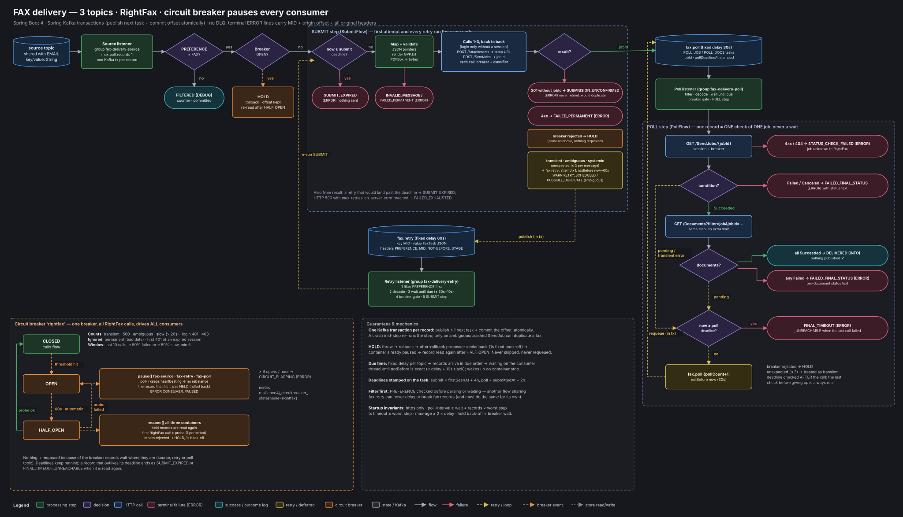

# fax-delivery: design

This document explains what the service does, every decision behind it and why, and how to run and
operate it. Section 17 lists what must be verified against your environment before production.



Contents

1. Requirements
2. Topics and the record contract
3. Packages
4. The flow, step by step
5. Failure taxonomy and classification
6. Circuit breaker: consumers stop while it is OPEN
7. Kafka transactions, commits and duplicates
8. Delays: how "wait until due" works
9. Deadlines: time-bound exhaustion
10. RightFax client, session and security
11. Document generation
12. Logging, metrics, health, alerts
13. Configuration reference
14. Startup invariants
15. Sharing the retry topic with another flow
16. Operations runbook
17. Assumptions, limitations, testing status

---

## 1. Requirements

| Requirement | How it is met |
|---|---|
| Spring Boot 4, plain consumers (no Kafka Streams) | Spring Kafka `@KafkaListener` containers built from explicit container factories. |
| Only 3 topics: source, status poll, retry | Source topic (existing), `fax.retry`, `fax.poll`. No error topic: the ERROR log line is the dead-letter record. |
| Filter `PREFERENCE=FAX` | Header check before anything else, on the source topic and (configurable) on retry and poll. |
| Login (rf-session cookie), upload, send job, poll status | Calls 1–3 back to back in one step; status polled from `fax.poll`. |
| Temp attachment URL must be used immediately | Upload and send job run in the same method; the URL is never stored or published. |
| Duplicates acceptable in rare cases | Ambiguous failures are retried and logged `POSSIBLE_DUPLICATE`; a 201 without a job id is never retried. |
| Nothing missed; failures logged | Every record ends in exactly one terminal outcome line with MID, origin offset and all original headers. |
| Retries delayed, never immediate | Fixed 60s delay on `fax.retry`; no code path republishes with `notBefore = now`. |
| Time-bound exhaustion | Submit deadline = firstSeenAt + 4h; poll deadline = submittedAt + 2h. Both are stamped on the task, configurable, and checked on every step. |
| Breaker OPEN → consumers stop; HALF_OPEN → traffic again; then CLOSED or OPEN | `BreakerConsumerControl` pauses/resumes all three containers on breaker transitions; records that meet an open breaker are held, never requeued. |
| Everything configurable | Endpoints, auth style, field names, response pointers, conditions, delays, deadlines, breaker, Kafka, headers, template, PDF. |
| Separate packages | One package per concern (section 3). |

---

## 2. Topics and the record contract

| Topic | Producer | Consumer group | Delay | Contents |
|---|---|---|---|---|
| source (existing) | upstream | `fax-delivery-source` | none | Preference records; EMAIL and others are filtered out |
| `fax.retry` | this service (and later maybe another flow) | `fax-delivery-retry` | fixed 60s | SUBMIT tasks that failed transiently |
| `fax.poll` | this service | `fax-delivery-poll` | fixed 30s | POLL_JOB / POLL_DOCS tasks |

**Recommended topic settings** for `fax.retry` and `fax.poll`:

- 3 partitions, replication factor 3, `cleanup.policy=delete`.
- Retention of at least 7 days. Retention must exceed the longest outage plus the deadline, otherwise a waiting task can be deleted before it is read.
- Keys are MIDs, so all tasks of one message land in the same partition.

**Headers on every retry/poll record:**

| Header | Value | Why |
|---|---|---|
| `PREFERENCE` | `FAX` | The filter runs without parsing the value. |
| `MID` | message id | Tracing. |
| `X-FAX-NOT-BEFORE` | epoch ms | The due-time wait runs without parsing the value. |
| `X-FAX-STAGE` | SUBMIT / POLL_JOB / POLL_DOCS | Debugging and tooling. |
| `X-FAX-TASK-VERSION` | 1 | Schema evolution. |

All names are configurable under `app.headers`.

**Value (`FaxTask`, JSON):**

```json
{ "version": 1, "stage": "SUBMIT", "mid": "MID-123",
  "origin": {"topic": "preference-delivery", "partition": 3, "offset": 88123, "key": "k", "timestamp": 1761900000000},
  "originHeaders": {"PREFERENCE": "FAX", "MID": "MID-123"},
  "payload": "<original source JSON, SUBMIT only>",
  "firstSeenAt": 1761900000000, "submitDeadlineAt": 1761914400000,
  "attempt": 2, "serverErrorAttempts": 0, "unexpectedCount": 0,
  "jobId": null, "submittedAt": 0, "pollDeadlineAt": 0, "pollCount": 0,
  "notBefore": 1761900120000, "lastStatus": null, "lastError": "reason=REQUEST_NOT_SENT ..." }
```

Design notes on the task:

- **Immutable.** Every step produces a new task (one record) or nothing.
- **The original payload, not the PDF, is carried while in SUBMIT.** The PDF is rebuilt on retry. A PDF would bloat the topic, and the temp URL is useless later anyway. The payload is dropped once the job id is known.
- **Original headers are carried along,** so the terminal line hours later is as complete as the first one.

---

## 3. Packages

```
com.example.faxdelivery
├── config       *Props records (one per concern), KafkaInfrastructureConfig, RightFaxConfig,
│                DocumentConfig, CoreConfig (JsonMapper, Clock), StartupInvariants
├── error        failure taxonomy, HttpFailureClassifier, BreakerRejectedException, HoldRecordException
├── http         HttpProps, WebClientFactory (one bounded pool per downstream)
├── kafka        PreferenceFilter, TaskHeaders, TaskPublisher, DueTimeWaiter, UncommittedOffsetGuard,
│                RollbackRetryListener
├── task         FaxTask, TaskStage, Origin, TaskCodec, InvalidTaskException
├── listener     SourceListener, RetryListener, PollListener, TaskRecordHandler, ListenerIds
├── flow         Decision (sealed), SubmitFlow, PollFlow, DecisionExecutor
├── message      FaxRequest, FaxRequestMapper (JSON pointers)
├── document     FaxDocumentFactory, TemplatePdfDocumentFactory, FaxTemplateRenderer, TemplateHelpers,
│                TextPdfRenderer
├── rightfax     RightFaxOperations, RightFaxGateway, RightFaxApi, WebClientRightFaxApi,
│                RightFaxResponseReader, RightFaxSessionManager, JobStatus, DocumentStatus,
│                Condition, ConditionResolver
├── resilience   ResilienceConfig, BreakerFactory, BreakerGate, BreakerConsumerControl
├── logging      Outcome, OutcomeLogger, LogContext, MdcScope, HeaderRenderer
└── health       FaxDeliveryHealthIndicator
```

**Pure core, thin shell.** `SubmitFlow` and `PollFlow` only decide. They take a task and "now", and return a `Decision`: `PublishRetry`, `PublishPoll`, `Terminal` or `Hold`. They never touch Kafka. `DecisionExecutor` applies the decision. Every business rule is therefore unit-testable without Kafka, and the tests in `flow/` cover every branch.

**Two RightFax layers.**
- `RightFaxApi` is raw REST, replaceable (e.g. to plug in an existing RFInjector login).
- `RightFaxGateway` adds what every call needs: the session, the breaker and the classifier.

The flows only know `RightFaxOperations`.

---

## 4. The flow, step by step

### 4.1 Source listener (`fax-delivery-source`)

1. **Context.** Render the headers, read the MID and put MID/origin/stage into the MDC.
2. **Filter.** If `PREFERENCE != FAX`, log `FILTERED` (DEBUG + counter), return, and the offset is committed.
3. **Breaker gate.** If the breaker is OPEN, HOLD: roll back, keep the offset, re-read after HALF_OPEN (section 6).
4. **Build the first task.** `firstSeenAt` is the record's Kafka timestamp (capped at now). Time spent waiting on the source topic, for example while paused by the breaker, therefore counts against the submit deadline.
5. **Run `SubmitFlow`** (4.2) and apply the decision.

### 4.2 SUBMIT step (`SubmitFlow`), first attempt and every retry

1. **Deadline.** If `now ≥ submitDeadlineAt`: `SUBMIT_EXPIRED`. Nothing is sent: a payment fax past its business window is not worth sending.
2. **Map, render, PDF.** Bad data ends here:
   - JSON, fax number or required fields invalid → `INVALID_MESSAGE`;
   - template or PDF failure → `FAILED_PERMANENT`.

   This happens before any RightFax call, so bad data never reaches RightFax and never opens the breaker.
3. **Calls 1–3, back to back:** login (only without a valid session), `POST /Attachments` → temp URL, `POST /SendJobs` → job id.
4. **Result:**

| Result | Decision |
|---|---|
| job id | Publish a `POLL_JOB` task to `fax.poll`: `notBefore = now + 30s`, `pollDeadlineAt = now + 2h`. Log `SUBMITTED`. |
| breaker rejected | HOLD |
| 201 without job id | `SUBMISSION_UNCONFIRMED`, never retried (the job is very likely queued) |
| other permanent (4xx, attachment URL missing) | `FAILED_PERMANENT` |
| 500 with `max-retries-on-server-error ≥ 0` reached | `FAILED_EXHAUSTED` |
| transient / systemic | Publish to `fax.retry`: `attempt+1`, `notBefore = now + 60s`. Log `RETRY_SCHEDULED`, or `POSSIBLE_DUPLICATE` if ambiguous. If `now + 60s` is past the deadline: `SUBMIT_EXPIRED` now. |
| unclassified exception (a bug) | Same as transient, at most `max-unexpected` (3) times per message, then `UNEXPECTED_EXHAUSTED` with stack trace |

### 4.3 Retry listener (`fax-delivery-retry`) and poll listener (`fax-delivery-poll`)

Both use `TaskRecordHandler`, and the order matters:

1. **PREFERENCE filter first.** Foreign records are acknowledged at once and never waited on. This is what makes sharing `fax.retry` with another flow safe.
2. **Decode** the task. Undecodable or unknown version → `INVALID_TASK` (terminal).
3. **Wait until due**, using the `X-FAX-NOT-BEFORE` header (section 8).
4. **Breaker gate.** OPEN → HOLD.
5. **Run the step.** Retry runs `SubmitFlow` (4.2), poll runs `PollFlow` (4.4). Apply the decision.

### 4.4 POLL step (`PollFlow`): one record is one check of one job

The listener never waits on a job. A job that takes 40 minutes is about 80 short records over time, so other jobs on the same partition are never blocked.

| Stage | Call | Result → decision |
|---|---|---|
| POLL_JOB | GET job | `Failed`/`Canceled` → `FAILED_FINAL_STATUS`. `Succeeded` → GET documents right away, in the same step. Anything else → not final. |
| POLL_DOCS | GET documents | All `Succeeded` → `DELIVERED` (INFO), nothing published. Any `Failed`/`Canceled` → `FAILED_FINAL_STATUS` with every failed document's status text. Otherwise → not final. |
| either | 4xx / 404 | `STATUS_CHECK_FAILED` (the job is unknown to RightFax) |
| either | breaker rejected | HOLD |
| either | transient error | not final (with `lastError`) |
| either | unclassified exception | not final, at most 3 times, then `UNEXPECTED_EXHAUSTED` |

**Not final.** If `now ≥ pollDeadlineAt` → `FINAL_TIMEOUT`, or `FINAL_TIMEOUT_UNREACHABLE` when the last call itself failed (ops should check RightFax by job id; the fax may have gone out). Otherwise, publish the next poll task: `pollCount+1`, `notBefore = now + 30s`, `lastStatus` kept.

The deadline is checked **after** the call, so the last check before giving up is always a real one. Errors never kill a job early; only time does.

---

## 5. Failure taxonomy and classification

| Type | Meaning | Breaker |
|---|---|---|
| `PermanentFailureException` | Can never succeed as-is | ignored |
| `TransientFailureException` | Try again later; `ambiguous` = may have been processed | counted |
| `ServerErrorFailureException` | HTTP 500 (can be capped) | counted |
| `SystemicFailureException` | Credentials or permissions broken: retried, never dropped | counted |
| `SessionExpiredException` | First 401 on a session call: re-login and repeat once | ignored |
| `BreakerRejectedException` | Breaker not permitting: the record is held | not a call |

`HttpFailureClassifier`:

| Observation | Result |
|---|---|
| 401, 403 | Systemic |
| 408, 429, 503 | Transient, not processed |
| `permanent-statuses` (400, 404, 409, 422), any other 4xx | Permanent |
| 500 | ServerError, ambiguous |
| 502, 504, other 5xx | Transient, ambiguous |
| connect refused/timeout, DNS, no route, TLS handshake, pool acquire timeout | Transient, not sent |
| response timeout, reset, premature close, other IO, call timeout | Transient, ambiguous |
| anything else | Transient, ambiguous (never lose a message to an unknown error) |

**Why 401/403 are retried, not dropped.** An expired or rotated password would otherwise drop every fax until someone noticed. Here they count toward the breaker. It opens, the consumers pause, nothing is lost, and the breaker alert fires.

---

## 6. Circuit breaker: consumers stop while it is OPEN

### 6.1 Configuration (`app.circuit-breaker`)

- **One breaker (`rightfax`) for all calls:** login, upload, send job, job status, documents. They all go to the same server: if one call sees an outage, all of them have one.
- **Thresholds:** count-based window of 10 calls, minimum 5. Opens at ≥ 50% failed, or ≥ 80% slow (> 20s). A crawling RightFax opens the breaker instead of quietly eating poll budgets.
- **Recovery:** `wait-duration-in-open-state` 60s, then 1 permitted call in HALF_OPEN.
- **Automatic OPEN → HALF_OPEN is mandatory.** While OPEN the consumers are paused, so no call could ever trigger the transition.

### 6.2 State machine and consumer control (`BreakerConsumerControl`)

| Transition | Action |
|---|---|
| → OPEN / FORCED_OPEN | `pause()` fax-source, fax-retry and fax-poll. `poll()` keeps running, so heartbeats continue and no rebalance happens, but no records are returned. ERROR `CONSUMER_PAUSED`. |
| → HALF_OPEN (after 60s, automatic) | `resume()` all three. Held records are read again; the first RightFax call is the probe. |
| HALF_OPEN → CLOSED (probe ok) | Traffic flows; `resume()` is a no-op. |
| HALF_OPEN → OPEN (probe failed) | Paused again; next HALF_OPEN after another 60s. |

### 6.3 HOLD: what happens to the record that meets the open breaker

1. The listener throws `HoldRecordException`. It has no stack trace; this is control flow, not an error.
2. The container rolls back the Kafka transaction, so nothing is published and the offset is not committed.
3. The after-rollback processor seeks back to the record and its successors. Holds use a fixed 1s back-off with no limit, so a held record is never skipped.
4. The container is paused, because the pause was requested when the breaker opened. The record is read again after HALF_OPEN.

Nothing is requeued because of the breaker. Records wait where they are: on the source topic, the retry topic or the poll topic. Deadlines keep running, so a record that outlives its deadline during an outage ends as `SUBMIT_EXPIRED` or `FINAL_TIMEOUT_UNREACHABLE` when it is read again.

In HALF_OPEN with all probe permits in use, other records get "rejected". They are held with the same 1s back-off and succeed once the probe closes the breaker.

### 6.4 Why the container pause and the per-record wait don't fight

**Verified against Spring Kafka 4.1.1's `KafkaMessageListenerContainer`:**
- `resumePartitionsIfNecessary()` only runs when the consumer is not container-paused.
- A container resume excludes partitions paused individually.

**This design doesn't pause partitions individually anyway.** The due-time wait happens on the consumer thread (section 8), and a container pause requested during that wait takes effect at the next poll. After the wait, the breaker gate holds the record if the breaker is OPEN.

### 6.5 Breaker metrics and logs

| What | Where |
|---|---|
| Breaker state, failure rate, slow-call rate, call counts | `resilience4j_circuitbreaker_*{name="rightfax"}` metrics |
| Transitions | `CIRCUIT_OPEN` (ERROR, with failure and slow rates), `CIRCUIT_HALF_OPEN` (WARN), `CIRCUIT_CLOSED` (INFO) |
| Flapping | `CIRCUIT_FLAPPING` (ERROR) when it opens more than 6 times in an hour |

---

## 7. Kafka transactions, commits and duplicates

**One transaction per record.** Every fax container has a `KafkaTransactionManager` and `AckMode.RECORD`. For each record, the published next task (if any) and the consumed offset commit atomically. The next task of a step is therefore published exactly once
(never lost, never twice), even across crashes and rebalances.

**Other settings:**

| Setting | Value | Why |
|---|---|---|
| producer | `acks=all`, idempotent, transactional | Exactly one next task per step |
| `transaction-id-prefix` | `fax-delivery-${HOSTNAME}-` | Must be unique per pod, or two pods fence each other |
| consumer `isolation.level` | `read_committed` | Never see tasks from aborted transactions |
| error handler | none on these containers | A listener exception rolls back and goes to the after-rollback processor |

**After-rollback processor back-off:**
- Holds: fixed 1s, unlimited.
- Infrastructure failures (Kafka send or commit): exponential 1s → 60s, unlimited.

The recoverer that would skip a record is unreachable by construction.

**Where duplicates can still come from** (business-approved, rare, traceable):

1. **Ambiguous SendJob** (timeout, reset, 500/502/504): retried by design and logged `POSSIBLE_DUPLICATE`.
2. **Crash after a successful SendJob but before the transaction commits:** the step runs again on restart. The window is the few milliseconds between the HTTP response and the commit.

Setting `app.rightfax.send-job.mid-field` (e.g. a billing-code field) puts the MID into RightFax, so any duplicate can be found by MID.

**Never a duplicate source:** a 201 without a readable job id. It is terminal (`SUBMISSION_UNCONFIRMED`), with the raw body logged.

---

## 8. Delays: how "wait until due" works

Every record on a delayed topic has the same delay (60s retry, 30s poll), and records are appended in time order. They therefore arrive in due-time order. When the record in hand is not due, nothing behind it on that partition is due either. Waiting on the consumer thread until it is due is equivalent to pausing that partition, with no pause bookkeeping.

`DueTimeWaiter`:

- **Bounded:** the wait is at most the topic delay plus `due-wait-slack` (10s). A bogus far-future header or clock skew can't block a partition.
- **Stoppable:** `ListenerUtils.stoppableSleep` wakes when the container stops. A stop during the wait holds the record.
- **Concurrency requirement:** concurrency must be ≥ partitions per instance (defaults: concurrency 3, 3 partitions). Then one thread never waits on behalf of two partitions. If it ever does (e.g. partitions added later), the other partition is only delayed, never lost.

The only immediate attempt is the first one, from the source listener. No code path republishes with `notBefore = now`.

---

## 9. Deadlines: time-bound exhaustion

| Deadline | Stamped when | Default | Ends as |
|---|---|---|---|
| submit: `firstSeenAt + app.submit.max-age` | first task built (from the source record timestamp) | 4h | `SUBMIT_EXPIRED` (checked before every attempt and before scheduling a retry) |
| poll: `submittedAt + app.poll.max-age` | RightFax returns the job id | 2h | `FINAL_TIMEOUT` / `FINAL_TIMEOUT_UNREACHABLE` (checked after every call) |

Deadlines are stamped on the task, so changing `max-age` later only affects new messages; in-flight ones keep their deadline. Counts never end a message, with two narrow exceptions:
- the optional HTTP 500 cap;
- `max-unexpected`, which bounds bugs.

A burst of transient errors can't exhaust a message; only time can. Both values are business decisions: how late is a fax still worth sending, and how long do we wait for a final status.

---

## 10. RightFax client, session and security

**`WebClientRightFaxApi`** makes the raw calls.
- **Blocking on purpose:** the outcome must be known before the offset commits.
- **Timeouts:** connect 5s, response 25s, and a hard per-call cap of 30s that includes pool acquisition.
- **Own connection pool,** with `max-idle-time` below a typical load-balancer idle timeout. Stale pooled connections would otherwise show up as ambiguous resets.

**Everything about the contract is configuration** (`app.rightfax.*`):
- login method, path and style (`BASIC`, `JSON` or `FORM`, with the field names);
- cookie name;
- upload part name and URL pointer;
- send-job field names, plus a MID field and static extra fields;
- job-id pointer;
- job and documents paths and pointers;
- success and failure condition values.

`RightFaxResponseReader` reads values with JSON pointers (RFC 6901).

**`RightFaxSessionManager`:**
- **Lifetime:** reuses the cookie until `session-ttl − refresh-before`, or until a 401 when no TTL is set.
- **Single flight:** one thread logs in while the others wait.
- **401 on a session call:** drop that cookie, log in, repeat the call once. A second 401 is Systemic `AUTH_REJECTED_AFTER_RELOGIN`.
- **Storage:** the cookie lives only in memory. It is never stored or logged; `cookie`, `set-cookie` and `authorization` are masked in header logs.

**Security:**
- **https enforced at startup.** A non-https `base-url` fails startup unless `allow-insecure-http=true` (local stubs only), because Basic credentials and the session cookie would otherwise travel in clear text.
- **Never disable certificate validation.** Add the internal CA to the JVM truststore instead.
- **Credentials come from environment variables** (`RIGHTFAX_USERNAME`, `RIGHTFAX_PASSWORD`). Feed them from your secrets store.

---

## 11. Document generation

**Template.** Handlebars.java renders `templates/GPP.txt`.
- Compiled once at startup, so a broken template fails the boot.
- HTML escaping is off: `&` stays `&`.
- Context: the whole source payload, plus `mid`, `faxNumber` (normalised) and `recipientName`.

**Helpers:**
- `padRight`: pads or truncates.
- `padLeft`: refuses to truncate. An amount wider than its field becomes `FAILED_PERMANENT`, because a silently cut number is a defect.
- `wrap`: word-wraps.

Register your own wrap helper in `TemplateHelpers.register`.

**PDF.** `TextPdfRenderer` uses PDFBox 3.0.8 (Apache 2.0).
- An embedded monospace TTF (Cousine, OFL licence, in `resources/fonts`) instead of Standard-14 Courier, which only encodes WinAnsi.
- Tabs expanded, control characters removed.
- Glyphs the font lacks become `?` instead of throwing.
- Over-long lines are hard-wrapped, never clipped. Pagination is by line count.
- Defaults are fax-friendly: Letter, 10pt, 54pt top margin (the receiving fax prints its header line there).

---

## 12. Logging, metrics, health, alerts

**One line per step** on logger `fax.outcome`:

```
outcome=RETRY_SCHEDULED mid=MID-123 stage=SUBMIT origin=preference-delivery-3@88123 at=fax.retry-1@410
  attempt=2 polls=0 jobId=null detail="attempt=2 retryInMs=60000 reason=REQUEST_NOT_SENT ..." headers={PREFERENCE=FAX, MID=MID-123}
```

- **Structured output:** the same fields are SLF4J key/values, so the `json` profile (ECS) emits them as JSON fields.
- **MDC on every line:** `mid`, `origin`, `at` and `stage` are on every line written while a record is handled, including WebClient and Spring Kafka lines.
- **No payloads in logs:** coordinates, MID and headers are enough to re-read the record.

| Outcome | Level | Terminal |
|---|---|---|
| FILTERED | DEBUG | yes |
| INVALID_MESSAGE, INVALID_TASK | ERROR | yes |
| HELD | WARN | no |
| SUBMITTED | INFO | no |
| RETRY_SCHEDULED, POSSIBLE_DUPLICATE | WARN | no |
| SUBMIT_EXPIRED, SUBMISSION_UNCONFIRMED, FAILED_PERMANENT, FAILED_EXHAUSTED, UNEXPECTED_EXHAUSTED | ERROR | yes |
| STATUS_PENDING | DEBUG | no |
| STATUS_CHECK_RETRY | WARN | no |
| DELIVERED | INFO | yes |
| FAILED_FINAL_STATUS, FINAL_TIMEOUT, FINAL_TIMEOUT_UNREACHABLE, STATUS_CHECK_FAILED | ERROR | yes |

**Other lines:**

| Logger | Lines |
|---|---|
| `fax.circuit` | `CIRCUIT_*`, `CONSUMER_PAUSED`, `CONSUMER_RESUMED` |
| `fax.rollback` | `ROLLED_BACK` (infrastructure), `HELD_RETRY` (DEBUG), `UNRECOVERABLE` (should never appear) |
| rebalance listener | `NO_COMMITTED_OFFSET` (ERROR, with the skipped offset range) |

**Metrics:**
- `fax_outcome_total{outcome,stage}`
- `resilience4j_circuitbreaker_*{name="rightfax"}`
- Kafka client metrics, with consumer lag per group best taken from the broker side.

**Health:** `faxDelivery` is always UP, with breaker state and every container's running/paused state as details. It is deliberately not in liveness or readiness: restarting pods can't fix RightFax and only causes rebalances.

**Alerts:**

| Alert | Condition |
|---|---|
| Any terminal ERROR | `increase(fax_outcome_total{outcome=~"INVALID_.*\|SUBMIT_EXPIRED\|SUBMISSION_UNCONFIRMED\|FAILED_.*\|UNEXPECTED_EXHAUSTED\|FINAL_TIMEOUT.*\|STATUS_CHECK_FAILED"}[5m]) > 0` |
| Breaker open too long | OPEN for more than 5 min |
| Breaker flapping | Any `CIRCUIT_FLAPPING` line |
| Infrastructure trouble | `fax.rollback` `ROLLED_BACK` lines |
| Skipped records | Any `NO_COMMITTED_OFFSET` |
| Stuck delayed topics | Lag on `fax-delivery-retry` / `fax-delivery-poll` growing while the breaker is CLOSED |

---

## 13. Configuration reference

All properties are in `application.yml` with comments. Defaults live in the `*Props` records, so omitted keys are safe.

| Prefix | Contents |
|---|---|
| `app.kafka` | bootstrap servers, transaction-id prefix (unique per pod), transaction timeout, isolation, raw client properties (security) |
| `app.topics` | source, retry, poll |
| `app.consumers.{source,retry,poll}` | group-id, concurrency, max-poll-records, max-poll-interval, auto-offset-reset, auto-startup, shutdown-timeout |
| `app.headers` | header names (preference, mid, not-before, stage, task-version) |
| `app.filter` | preference value (`FAX`), filter on retry topic, filter on poll topic |
| `app.message` | JSON pointers into the source payload, required pointers, fax number pattern |
| `app.submit` | retry-delay, max-age, max-unexpected, max-retries-on-server-error |
| `app.poll` | delay, max-age, max-unexpected |
| `app.timing` | due-wait slack, hold back-off, infrastructure back-off |
| `app.circuit-breaker` | thresholds, slow calls, wait in OPEN, half-open calls, flapping threshold, pause-consumers-when-open |
| `app.rightfax` | base-url, allow-insecure-http, credentials, login, attachments, send-job, job, documents, conditions, permanent-statuses, http |
| `app.document` | template, file-name pattern, PDF font/size/margins/page size |
| `app.logging` | masked headers, header value length, detail length |

Profiles:
- `json`: ECS JSON logs.
- `local`: http RightFax stub on localhost allowed.

---

## 14. Startup invariants

`StartupInvariants` stops the boot when values contradict each other. Each rule prevents a real failure:

| Rule | Prevents |
|---|---|
| RightFax base-url is https (unless explicitly allowed) | Credentials and cookie in clear text |
| source, retry and poll are three different topics | Tasks consumed by the wrong listener |
| `call-timeout ≥ connect + response timeout` | A call cut off before its own response timeout |
| `max-age ≥ 2 × delay` for submit and poll | Deadlines that can never be met |
| `transaction-timeout ≥ worst submit step + 30s` (worst step = 5 calls + rendering) | Aborted transactions mid-step |
| per consumer: `max-poll-interval ≥ wait + max-poll-records × worst step + 30s` | Rebalance storms that replay records (more duplicates) |
| `hold-backoff < breaker wait-duration-in-open-state` | Holds that outlive the pause |

---

## 15. Sharing the retry topic with another flow

You plan to let another flow use `fax.retry` with its own consumer group. That works, under these rules:

1. **Filter first, in both consumers.** This service checks `PREFERENCE` before parsing or waiting, so foreign records are acked at once and never delay fax records. The other flow must do the same for its own records. Otherwise it would wait behind fax records' due times, and vice versa.
2. **A distinct discriminator.** The other flow must set `PREFERENCE` to a value other than `FAX` on every record it publishes there. A record without the header is filtered out (not processed) by the fax consumer.
3. **Each flow waits only on its own records.** The fax consumer never waits on a foreign record, so the other flow may use a different delay. Within each flow the delay must be fixed (section 8).
4. **Retention covers both flows' longest outage plus deadline.** Partition count, retention and ACLs are shared decisions.
5. **Schema.** Values differ per flow. The fax consumer only decodes records that passed the filter; a fax record it cannot decode is logged `INVALID_TASK`.
6. **Transactions.** The fax consumer reads `read_committed`, so the other flow can use transactional or plain producers.
7. **Observability.** Fax-filtered records are counted (`fax_outcome_total{outcome="FILTERED"}`). Lag per consumer group shows whether either flow is falling behind.

---

## 16. Operations runbook

**A terminal ERROR line.** It carries the MID, the origin (`topic-partition@offset`) and all original headers.

1. Read the source record at that offset (e.g. `kafka-console-consumer --partition P --offset O --max-messages 1`).
2. Fix the cause.
3. Re-produce the record with the same headers to run it again.

Outcome-specific notes:
- **`FINAL_TIMEOUT_UNREACHABLE` / `FINAL_TIMEOUT`:** look up the job id in RightFax first. The fax may have gone out.
- **`SUBMISSION_UNCONFIRMED`:** RightFax answered 2xx without a readable job id. Check RightFax for the job (the MID field helps), then fix `send-job.job-id-pointer`.

**Breaker OPEN.**
- **What to expect:** all consumers are paused, nothing is lost, and recovery is automatic. Check RightFax and its credentials.
- **Afterwards:** after a long outage, expect `SUBMIT_EXPIRED` and `FINAL_TIMEOUT_UNREACHABLE` for messages that outlived their deadlines.

**`NO_COMMITTED_OFFSET`.** A partition started at `latest` (source) or `earliest` (retry/poll). The logged range on the source topic was not processed; replay it deliberately if it matters.

**A payload that keeps getting HTTP 500.** The same MID keeps showing `POSSIBLE_DUPLICATE` with `SERVER_ERROR`. Set `app.submit.max-retries-on-server-error: 5`; after 5 retries it ends as `FAILED_EXHAUSTED`.

**Credential rotation.** Update the secret and restart. The first call after a login failure opens the breaker, and the consumers pause until the new credentials work.

**Scaling.** Add partitions to `fax.retry` / `fax.poll` and raise `concurrency` to match (≥ partitions per instance).

---

## 17. Assumptions, limitations, testing status

### Verify before production

1. **RightFax contract:**
   - login method, path and style;
   - upload part name and URL pointer (`/0`);
   - send-job body field names and job-id pointer (`/Id`);
   - job and documents paths and pointers (`/Condition`, `/Items`);
   - condition values.

   All of it is configuration; check it against your RightFax version and `docs/rightfax-info`.
2. **Source payload schema:** set `app.message.*` pointers and `required-pointers`.
3. **Business values:** `app.submit.max-age` and `app.poll.max-age`.
4. **Topics:** create `fax.retry` and `fax.poll` with the settings in section 2. Grant the transactional id ACL on the `fax-delivery-` prefix if your cluster uses ACLs.
5. **`GPP.txt`:** the shipped file is a sample.

### Known limitations (accepted)

- **Duplicates possible** in the two cases in section 7.
- **Head-of-line blocking:** a record held during HALF_OPEN contention delays its partition by about 1s.
- **No error topic:** terminal ERROR log lines are the dead-letter record, so logs must be shipped and retained.

### Testing status

**Unit tests** (`mvn verify`, no Kafka or network needed):

| Test | Covers |
|---|---|
| `SubmitFlowTest` | Every submit branch: accepted, not-sent retry, ambiguous retry, breaker hold, missing job id, expired deadline, retry past deadline, invalid payload never calling RightFax, 500 cap, unexpected-exception budget |
| `PollFlowTest` | Pending, succeeded with docs in the same step, docs pending, failed document, transient reschedule, deadline after a real call, unreachable timeout, 404, breaker hold |
| `HttpFailureClassifierTest` | The classification table |
| `RightFaxResponseReaderTest` | Pointers, arrays, bare strings, missing values |
| `RightFaxSessionManagerTest` | Reuse, one re-login on 401, second 401 is Systemic, TTL |
| `DocumentRenderingTest` | Helpers, no HTML escaping, PDF edge cases, pagination, refusing to truncate an amount |
| `TaskCodecTest` | Round trip, garbage, unknown version |

**Not yet included (recommended):**
- an integration test with Testcontainers Kafka plus a WireMock RightFax, covering breaker open → containers paused → half-open → resumed, and a held record not being skipped;
- a rebalance or shutdown test mid-step.

**Build status:** this project was written without access to Maven Central, so it has **not been compiled against its dependencies**.
- Every Spring Kafka, Kafka, Resilience4j, Jackson 3, PDFBox, Handlebars and Spring Boot 4 API used was checked against the source of the exact versions in the pom.
- The sources pass `javac` with no syntax errors; the only errors are the unresolvable dependencies.
- Run `mvn verify` first. Expect at most small import or signature fixes.
