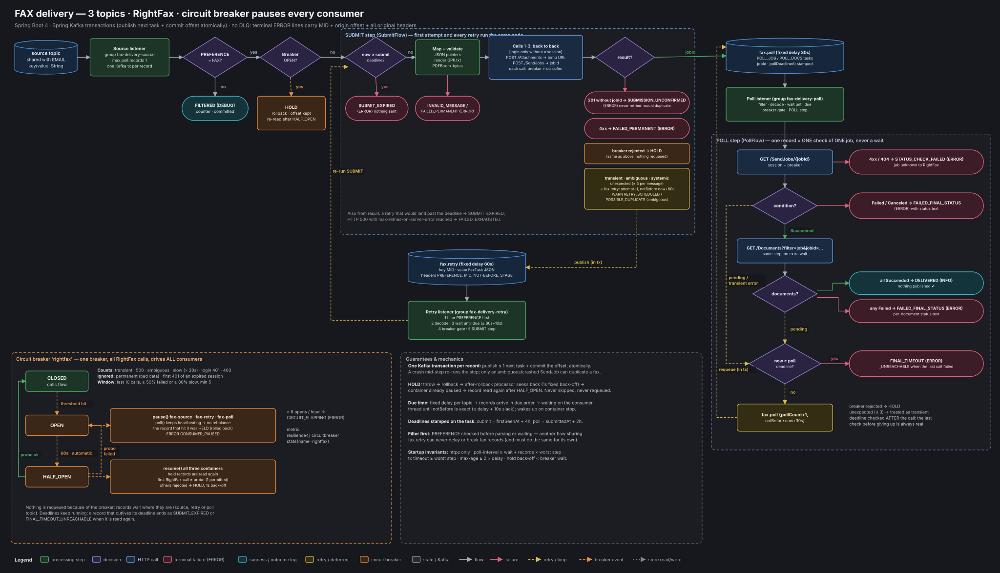

# fax-delivery

Spring Boot 4 service that delivers fax notifications through OpenText RightFax.

- Reads the shared source topic and keeps only records with header `PREFERENCE=FAX`.
- Renders the `GPP.txt` template into a PDF.
- Logs in, uploads the PDF and sends the job, back to back.
- Polls the job until RightFax reports a final status or a deadline passes.

It uses three topics in total: the existing source topic, `fax.retry` (fixed 60s delay) and `fax.poll` (fixed 30s delay).

One Resilience4j circuit breaker covers every RightFax call. While it is OPEN, all three consumers are paused. On HALF_OPEN they resume and the next call is the probe. Nothing is requeued because of the breaker, and nothing is lost.

There is no dead-letter topic. Every message ends in exactly one outcome log line: `DELIVERED`, or one of the ERROR outcomes. Each line carries the MID, the origin offset and all original headers.



## Run

```bash
export KAFKA_BOOTSTRAP_SERVERS=localhost:9092
export RIGHTFAX_BASE_URL=https://rightfax.example.com/RightFax/API
export RIGHTFAX_USERNAME=... RIGHTFAX_PASSWORD=...
mvn spring-boot:run                                       # plain logs
mvn spring-boot:run -Dspring-boot.run.profiles=json       # ECS JSON logs
mvn spring-boot:run -Dspring-boot.run.profiles=local      # http://localhost:8090 RightFax stub allowed
```

Requires Java 21 and Maven. Create `fax.retry` and `fax.poll` before the first start. Tests: `mvn verify`.

## Sample source record

Headers: `PREFERENCE: FAX`, `MID: <message id>`

```json
{"faxNumber": "+1 416 555 0100", "recipientName": "ACME Ltd",
 "data": {"beneficiaryName": "John Doe", "amount": "1,250.00", "currency": "CAD",
          "valueDate": "2026-10-19", "message": "Your wire has been processed."}}
```

## Endpoints

- `/actuator/health`: the `faxDelivery` component shows breaker state and container states.
- `/actuator/health/liveness` and `/actuator/health/readiness`: use these for k8s probes.
- `/actuator/prometheus`

Everything else (design decisions, every setting, failure handling, runbook) is in [DESIGN.md](DESIGN.md).
